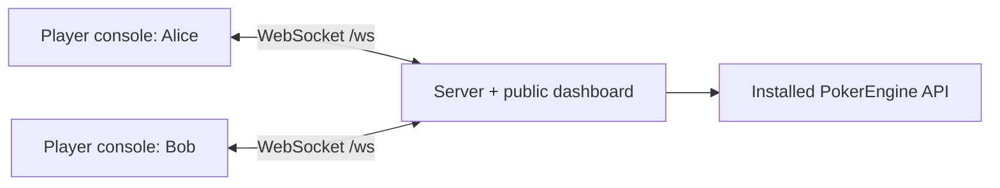

# PokerDemo

**A WebSocket poker server, a live terminal dashboard and two interactive player tables.**

PokerDemo demonstrates the installed [PokerEngine](https://github.com/pokerlost/pokerengine)
Python API. The engine owns poker rules, legal actions and settlement. This application
owns connections, typed messages, terminal interaction and local recording.

| Layer | Library | Responsibility |
| --- | --- | --- |
| Transport | websockets | WebSocket connections and pushed table updates |
| Contracts | Pydantic | Strict command, reply and snapshot models |
| Console | Textual / Rich | Card faces, legal-action menus and a public dashboard |
| CLI / configuration | Typer / Pydantic Settings | Explicit commands and lazy settings |
| Rules | Installed PokerEngine wheel | State transitions, validation and payouts |

## Quick start

Requires **CPython 3.14 on Linux x86-64**, `uv`, `tmux` and the owner-supplied
`pokerengine-2.0.0.dev2-cp314-cp314-linux_x86_64.whl`. Recording also requires
[asciinema agg](https://github.com/asciinema/agg). The private engine artifact is
not downloaded automatically; [prerequisites and checksum](docs/demo.md#prerequisites)
describe the exact dependency.

From this repository root:

```bash
python3.14 scripts/prepare.py --wheel /path/to/pokerengine-2.0.0.dev2-cp314-cp314-linux_x86_64.whl
make doctor
make demo
```

Preparation verifies the wheel and installs the locked environment. `make demo`
opens the server above Alice and Bob. **Click Deal hand in a player panel to start.**
Each player sees two own cards, the shared board, stacks and a clear turn indicator.
Click an action, or select it with Tab and Enter. Bet and Raise open a small amount
picker with Min, half-pot and pot presets; unavailable actions are disabled.
Switch panels by clicking, or with `Ctrl+B` then an arrow. The [play guide](docs/demo.md#play)
lists keyboard shortcuts, commands, showdown and the next hand.

## Play or record

| Command | What happens |
| --- | --- |
| `make demo` | Opens an interactive game; you control both players. |
| `make demo-attach` | Returns to an already running manual game. |
| `make demo-stop` | Stops this workspace's manual demo session. |
| `make demo-record` | Plays a scripted game in the background, prints progress and saves local files. |
| `make demo-record-open` | Records, then opens the completed GIF in your local viewer. |

**Recording does not open the game.** Allow about a minute for the scenario, then
additional rendering time. Progress messages show the current stage. The command
prints the GIF, five PNG frames and receipt paths when finished:

```text
.local/recordings/<run-id>/
├── demo.gif
├── frames/
├── session.cast
└── recording.json
```

The GIF shows both synthetic players' own cards, the shared board and the action
menu, including the raise picker. Each client still receives only its own hand;
the server monitor stays public. To hide hole cards instead:

```bash
POKERDEMO_RECORD_SHOW_CARDS=false make demo-record
```

Recording uses a separate session and leaves a manual game alone. No recordings
are uploaded or included in Git or distributions. See [recording and troubleshooting](docs/demo.md#record-a-game).

## How it fits together



```text
src/pokerdemo/
├── cli.py          # thin Typer entry points
├── settings.py     # explicit, lazy configuration
├── game/           # engine orchestration and player sessions
├── protocol/       # Pydantic wire contracts
├── network/        # WebSocket server and client transport
├── console/        # Textual applications and shared Rich presentation
└── runtime/        # tmux lifecycle, recording, rendering and tools
```

## Documentation

- 🎮 [Demo guide](docs/demo.md) — installation, controls, recording and recovery.
- 🧩 [Architecture](docs/architecture.md) — component ownership and data flow.
- 🔌 [Protocol](docs/protocol.md) · [Client](docs/client.md) — messages and console behavior.
- 🛠️ [Development](docs/development.md) · [Versions](docs/versioning.md) · [Release boundary](docs/releases.md).

This is a development demonstration with synthetic players and chips. It listens
only on loopback and has no production authentication, TLS or persistence.
The supplied wheel still requires private artifact access. Publishing source on
`main` does not make this a stable release or establish full test acceptance.

Code is [MIT licensed](LICENSE). Preserve [third-party notices](THIRD_PARTY_NOTICES.md)
and [transfer provenance](docs/migration-source.json). Historical recordings remain
in their original Git history and private backups.
